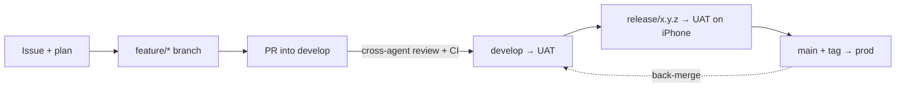

# Expense App

A personal expense-tracking **PWA for iPhone** that replaces a "Budget & Expense" Google Sheet: log a MoMo payment in under 5 seconds, budget with envelopes, track savings funds and BNPL debt, and automate the month-end allocation rule.

> **Status:** Phase 0 — engineering foundation. No app code yet.
> Built by Phú with two AI coding agents (Claude Code and Antigravity) using a GitFlow + PR review process. See [how we work](#how-we-work).

## Tech stack

Next.js (App Router) · TypeScript strict · Tailwind + shadcn/ui · Supabase (Postgres, RLS, Auth) · Zod · Vitest · Playwright (WebKit iPhone) · pnpm · Vercel · GitHub Actions

## Environments

| Env | Branch | Where |
| --- | --- | --- |
| dev | feature branches | localhost + local Supabase |
| uat | `develop`, `release/*` | Vercel Preview + Supabase `expense-uat` |
| prod | `main` (tag `v*`) | Vercel Production + Supabase `expense-prod` |

Details: [docs/operations/environments.md](docs/operations/environments.md).

## Documentation

Start at **[docs/README.md](docs/README.md)**. Highlights:

- [Product plan](docs/plan.md): what we are building and the roadmap
- [Architecture Decision Records](docs/adr/README.md): why it is built this way
- [Conventions](docs/README.md#conventions): branching, commits, PRs, files, code, database, docs
- [AI workflow](docs/ai-workflow.md): how the two agents and the human collaborate

## How we work

[CONTRIBUTING.md](CONTRIBUTING.md) has the short version.

## Getting started

Local setup instructions will be added in task P0-01 (`docs/guides/local-setup.md`).

## License

Copyright © 2026 Le Viet Vinh Phu. **All rights reserved.** The source is public for portfolio and reference only. No permission is granted to use, copy, modify or deploy it. See [LICENSE](LICENSE) and [ADR-0014](docs/adr/0014-public-repository.md).
