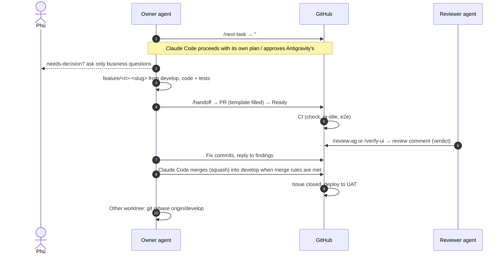

# AI Workflow — Claude Code × Antigravity × Phú

> Goal: two AI agents and one human work on one repo **without stepping on each other**, through the same GitFlow + PR process a real team would use.
> Decision records: [ADR-0011](adr/0011-gitflow-branching.md), [ADR-0013](adr/0013-github-issues-and-prs.md), [ADR-0015](adr/0015-two-agents-with-ownership.md).

---

## 1. Core principles

1. **One source of truth for rules:** `AGENTS.md` (shared) → links to [conventions](README.md#conventions). Claude Code reads `CLAUDE.md` (imports `AGENTS.md`); Antigravity reads `AGENTS.md` + `.agents/rules/*.md`.
2. **One source of truth for work:** `docs/plan.md` defines *what*; GitHub Issues + the Project board define *who / status*.
3. **Agents communicate through GitHub, not memory:** plans are issue comments, handoffs are PR descriptions, reviews are PR review comments.
4. **One branch per agent at a time**, one git worktree per agent.
5. **Contract-first:** Claude Code merges types/Zod/server actions (`src/lib/domain/`) before Antigravity builds UI on them.
6. **Claude Code is the tech lead** ([ADR-0017](adr/0017-claude-code-as-tech-lead.md)): it approves plans, decides technical questions, merges PRs and runs releases. **Phú** answers `needs-decision` questions, provides accounts/secrets, accepts releases on his iPhone and approves production deployments. Only Claude Code edits the definition files (rules, plan, ADRs, conventions, `.github/`), through a PR ([ADR-0016](adr/0016-claude-code-maintains-definition-files.md)).
7. **All written artifacts are in English.** Agents talk to Phú in Vietnamese in chat.

## 2. Roles

| | **Claude Code** (VS Code) | **Antigravity** | **Phú** |
| --- | --- | --- | --- |
| Main role | Architect, DB, domain/money logic, server, security, code reviewer | Frontend/UI, PWA, browser verification | Product owner, approver, release manager |
| Does | Schema, migrations, RLS, views, server actions, Zod, unit/integration/pgTAP tests, month-close engine, `/api/ingest`, CI workflows, iOS Shortcut docs | Screens, components, PWA (manifest, service worker, offline queue, safe areas), e2e tests, screenshots | Prioritises issues, approves plans, final review, merges, cuts releases, UAT on iPhone |
| Reviews | Antigravity's PRs (`/review-ag`) | Claude Code's PRs by **running the app** (`/verify-ui`) | Every PR before merge |
| Does not | Large UI redesigns without agreement | Edit DB, domain, server or auth code | — |

Path ownership: [files & folders §1.1](conventions/files-and-folders.md#11-ownership).

## 3. One-time setup

### 3.1 Repo, remote and worktrees

```bash
# Main repo — VS Code + Claude Code
cd expense-app
git init -b main && git add . && git commit -m "chore: bootstrap docs, conventions and agent rules"
git switch -c develop
gh repo create <owner>/expense-app --public --source . --push   # pushes current branch
git push -u origin main develop

# Worktree for Antigravity — open this folder in Antigravity
git worktree add ../expense-app-ag develop --detach
```

- `expense-app/` → Claude Code. `expense-app-ag/` → Antigravity. Both share one `.git`.
- Each agent creates its own `feature/<issue>-<slug>` branch from `origin/develop` inside its worktree.
- Each worktree needs its own `pnpm install` and `.env.local`. Dev ports: CC 3000, AG 3001.
- Run **one** local Supabase instance, started from the main repo; both worktrees point to it.
- Then apply the GitHub settings in [branching §7](conventions/branching.md#7-repository-settings-that-enforce-this) and create labels, milestones and the Project board ([issues](conventions/issues.md)).

### 3.2 Testing on the iPhone

iOS PWA features (Add to Home Screen, standalone, Web Push) need HTTPS:

- Quick checks: `http://<laptop-LAN-IP>:3000` in Safari on the same Wi-Fi.
- Real PWA checks: the Vercel preview URL of the PR or the UAT URL (`develop`).
- Playwright runs WebKit with an iPhone profile in CI. Phú still checks on the real device during UAT.

### 3.3 Claude Code

- Commands: `/next-task <issue>`, `/handoff`, `/review-ag <pr>`.
- Subagent `money-logic-reviewer`: runs before `/handoff` on money/DB changes.
- Plan mode for schema, month close, auth and CI work. `/clear` after each task.

### 3.4 Antigravity

- Workflows: `/next-ui-task <issue>`, `/handoff`, `/verify-ui <pr>`.
- If your Antigravity version does not pick up `.agents/`, rename the folder to `.agent/` (legacy name).
- Allow it to open the browser at `http://localhost:3001` (viewport 390×844).

## 4. Loop per task



### Features that need both agents (e.g. P1-04, P2-05, P3-07)

1. A parent issue with two sub-issues: logic (CC) and UI (AG, `Blocked by` the logic one).
2. Claude Code's PR merges into `develop` first.
3. Antigravity rebases on `origin/develop` and builds the UI on that contract.

### Safe parallel work

Parallel is fine when two issues **touch no common files**. Good pairs:

- CC: P1-02 (server actions) ‖ AG: P0-07 (PWA manifest)
- CC: P2-02 (month-close engine) ‖ AG: P2-04 (Funds UI on existing views)
- CC: P3-03 (ingest API) ‖ AG: P3-01 (offline queue)

### Releases

Claude Code cuts releases ([branching §4.2](conventions/branching.md#42-release)); Phú accepts them on his iPhone and approves the production deployment. Agents may be asked to fix bugs on `release/*` via `bugfix/` PRs targeting the release branch.

## 5. Prompt templates

| Goal | Prompt |
| --- | --- |
| Plan a Claude Code task | `/next-task 23` |
| Plan an Antigravity task | `/next-ui-task 31` |
| Approve an Antigravity plan | Tell Claude Code: `review the plan on issue #31`; it comments `Plan approved` or asks for changes |
| Merge a PR | Claude Code does it (`/merge 42`) once the merge rules are met |
| Hand off | `/handoff` |
| Claude Code reviews Antigravity | `/review-ag 42` |
| Antigravity verifies Claude Code | `/verify-ui 40 — test create/edit/delete transaction through the existing UI` |

### When the agents disagree

Both write their reasoning in the PR under `### Disagreement`. Claude Code decides technical disagreements; business questions go to Phú. Lasting rules become an ADR. An agent never "wins" by overwriting the other's code.

## 6. Quality tips

- **Context hygiene:** one issue per session. Read the issue + plan comment, not the whole history.
- **Tests are the fence:** money logic gets tests **before** any UI uses it. A "fix" that edits a test to pass is rejected.
- **Screenshots are evidence:** UI PRs include 390×844 screenshots with seed data.
- **Real data never enters the repo:** receipts are redacted ([files & folders §3.12](conventions/files-and-folders.md#312-sensitive-fixtures-momo-receipts)).
- **When stuck:** if one agent fails the same issue twice, hand it (with logs, in the issue) to the other agent.
