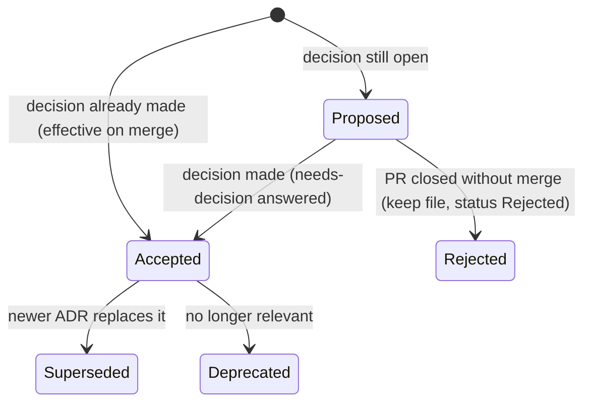

# Documentation Conventions

> Related: [files & folders §3.11](files-and-folders.md#311-documentation) · [ADR index](../adr/README.md)

Docs are code: they live in the repo, change in the same PR as the code they describe, and get reviewed.

---

## 1. Rules

1. **English only** ([ADR-0008](../adr/0008-english-docs-vietnamese-ui.md)). Vietnamese appears only when quoting UI text.
2. **Same-PR rule:** a PR that changes behaviour updates the affected docs in the same PR. Reviewers block PRs that leave docs stale.
3. File names are kebab-case `.md`. Root meta files (`README.md`, `CHANGELOG.md`…) are uppercase.
4. Every new doc is linked from [`docs/README.md`](../README.md). An orphan doc is a dead doc.
5. Use relative links (`../adr/0004-money-as-integer-vnd.md`) so they work on GitHub and locally.
6. Diagrams are **Mermaid** code blocks (they render on GitHub and diff cleanly). Images only for screenshots.
7. No personal data in docs or screenshots (public repo). Use seed data.

## 2. Doc types

| Type | Folder | Answers | Template |
| --- | --- | --- | --- |
| Product plan | `docs/plan.md` | What are we building and why? | — |
| ADR | `docs/adr/` | Why did we choose X? | [template](../adr/template.md) |
| Architecture | `docs/architecture/` | How is the system structured? | C4 levels + links to ADRs |
| Conventions | `docs/conventions/` | How do we work? | — |
| Guide | `docs/guides/` | How do I do X? | Goal / Prerequisites / Steps / Troubleshooting |
| Operations | `docs/operations/` | How do we run/deploy/recover it? | When to use / Steps / Verify / Rollback |
| Changelog | `CHANGELOG.md` | What changed in each version? | Keep a Changelog |

## 3. Architecture Decision Records

Format: [MADR](https://adr.github.io/madr/)-style, simplified. See [`docs/adr/template.md`](../adr/template.md).

### 3.1 When to write an ADR

Write one when a decision:

- is hard or expensive to reverse (data model, framework, hosting, auth), or
- affects how both agents work (process, ownership, conventions), or
- was the subject of a disagreement, or
- a future reader would ask "why on earth did they do it this way?"

Don't write one for choices fully covered by a convention doc or for routine library picks you could swap in an hour.

### 3.2 Lifecycle

- An ADR that records a decision **already made** (by Phú for business/process, or by Claude Code for technical matters under ADR-0017) is written with status **Accepted**; it takes effect when its PR is merged under [pull requests §6](pull-requests.md#6-merge-rules).
- An ADR whose decision is still open is written as **Proposed** and its question is labelled `needs-decision`. It is set to **Accepted** in the same PR once the decision is made.
- ADRs are immutable once accepted. To change a decision, write a new ADR with `Supersedes: ADR-NNNN` and set the old one's status to `Superseded by ADR-MMMM`. Changing only the status line of the old ADR is the one allowed edit.
- Numbers are never reused, including for rejected ADRs.

### 3.3 Writing style

- Context states the forces and constraints, not the solution.
- Decision is one sentence in active voice: "We will…".
- Consequences list both the good and the bad.
- Keep it under one screen. Link out for details.

## 4. CHANGELOG

- `## [Unreleased]` at the top. Every `feat`/`fix` PR adds a line under `Added` / `Changed` / `Fixed` / `Removed` / `Security`.
- The release PR moves `Unreleased` into `## [x.y.z] - YYYY-MM-DD`.
- Lines are written for the user of the app, not for developers: "Quick-add remembers the last account", not "refactor account store".

## 5. Agent context files

`AGENTS.md`, `CLAUDE.md`, `.agents/rules/*` are short and point to the conventions. They must not duplicate them, because duplicated rules drift apart. If an agent needs a rule, link the convention section.
