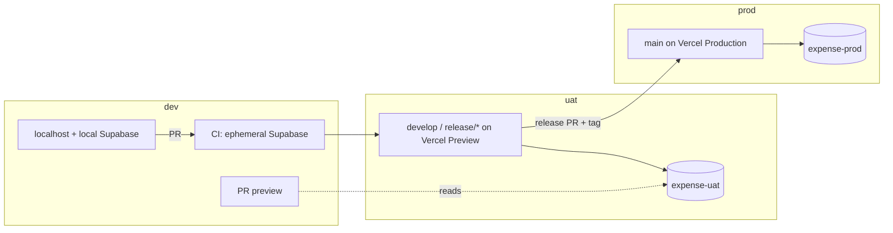

# Environments: dev / uat / prod

> Decision record: [ADR-0012 — Three environments on free tiers](../adr/0012-dev-uat-prod-environments.md).
> Related: [branching](../conventions/branching.md) · [database conventions](../conventions/database.md)

---

## 1. Overview

| | **dev** | **uat** | **prod** |
| --- | --- | --- | --- |
| Purpose | Build and test locally; CI | Acceptance testing on a real iPhone | Phú's real money data |
| Branches | any; PR previews | `develop`, `release/*`, `hotfix/*` | `main` (tag `v*`) |
| App | `pnpm dev` (localhost) · Vercel Preview per PR | Vercel Preview (branch alias) | Vercel Production |
| Database | Local Supabase (Docker, `supabase start`) · ephemeral Supabase in CI | Supabase project `expense-uat` | Supabase project `expense-prod` |
| Data | `seed.sql` (fictional) | `seed.sql` + test data created by hand (fictional) | Real. **Never copied to other envs.** |
| Auth | Local Inbucket magic links | Magic link to Phú's test email | Magic link / Google to Phú's real account |
| Deploy trigger | — | Push to `develop` / `release/*` / `hotfix/*` | Tag `v*` on `main`, manual approval |
| Migrations applied | `supabase db reset` | CI on push (§4) | CI on tag, after approval (§4) |

## 2. Configuration & secrets

All variables are validated at startup by `src/env.ts`. Where each value lives:

| Variable | Exposed to browser | dev | uat | prod |
| --- | --- | --- | --- | --- |
| `NEXT_PUBLIC_SUPABASE_URL` | yes | `.env.local` | Vercel *Preview* | Vercel *Production* |
| `NEXT_PUBLIC_SUPABASE_ANON_KEY` | yes (RLS protects data) | `.env.local` | Vercel *Preview* | Vercel *Production* |
| `SUPABASE_SERVICE_ROLE_KEY` | **no** | `.env.local` | Vercel *Preview* | Vercel *Production* |
| `NEXT_PUBLIC_APP_ENV` | yes | `development` | `uat` | `production` |
| `SUPABASE_ACCESS_TOKEN` (CLI) | **no** | — | GitHub Environment `uat` | GitHub Environment `production` |
| `SUPABASE_DB_PASSWORD` | **no** | — | GitHub Environment `uat` | GitHub Environment `production` |
| `SUPABASE_PROJECT_REF` | no (not secret) | — | GitHub Environment `uat` (variable) | GitHub Environment `production` (variable) |
| `BACKUP_ENCRYPTION_KEY` | **no** | — | — | GitHub Environment `production` |

Rules:

- `.env.example` lists every variable with a placeholder. `.env.local` is git-ignored.
- **Public repo:** CI logs are public. Never `echo` a secret and never print env in debug steps. Fork PRs get no secrets, and workflows never use `pull_request_target`.
- The UI shows a coloured `UAT` badge when `NEXT_PUBLIC_APP_ENV !== "production"`, so the two installed PWAs can't be confused on the iPhone.

## 3. Deployment pipeline

GitHub Actions owns deployment order (database first, then app). Vercel's automatic Git deployment is **disabled for `main`** (`vercel.json` → `git.deploymentEnabled.main: false`). Production is deployed by the workflow using the Vercel CLI.

| Workflow | Trigger | Steps |
| --- | --- | --- |
| `ci.yml` | every PR, push to `develop`/`main` | Job `check`: install → `pnpm check` (typecheck, lint, format, markdownlint, unit) → build. Added later: start Supabase → pgTAP + integration (P0-02), e2e on WebKit iPhone (P1-10) |
| `pr-title.yml` | PR opened, edited, synchronized | commitlint on the PR title (re-runs on title edits) |
| `deploy-uat.yml` | push to `develop`, `release/**`, `hotfix/**` | environment `uat` → `supabase db push` to `expense-uat` (Vercel deploys the preview itself) |
| `deploy-prod.yml` | push tag `v*` | environment `production` (**requires Phú's approval**) → encrypted backup → `supabase db push` to `expense-prod` → `vercel deploy --prod` → smoke test |
| `backup.yml` | nightly cron | environment `production` → `pg_dump` → encrypt → store (§5) |

## 4. Database migrations

- Migrations are applied **before** the app that needs them, so every migration must be backward compatible with the running app ([database §4](../conventions/database.md#4-migration-rules)).
- **One UAT database, several branches.** While a `release/*` branch is open, UAT must reflect that release. PRs labelled `db:migration` are therefore not merged into `develop` until the release is finished.
- PR previews read the UAT database. A PR whose migration is not yet on UAT is verified **locally**, not on its preview URL. The PR template asks for this.
- Rollback = **forward fix**. Write a new migration, release it as a hotfix. Restoring a backup is the last resort (§5).

## 5. Backups & recovery (prod)

The Supabase free tier has no point-in-time recovery, so we take our own backups:

- `backup.yml` runs nightly and before each production migration.
- The dump is **encrypted** (`age`) with `BACKUP_ENCRYPTION_KEY` before it leaves the runner. Workflow artifacts in a public repo are downloadable by others, so an unencrypted dump would leak personal finance data.
- Retention: 14 days of artifacts. Phú also downloads a monthly copy to personal storage.
- Restore procedure: `docs/operations/restore-backup.md` (written in task P0-00c; tested once on UAT before `1.0.0`).

## 6. Free-tier caveats

| Caveat | Impact | Mitigation |
| --- | --- | --- |
| Supabase pauses free projects after ~7 days without activity | UAT goes to sleep between releases | Resume from the dashboard before acceptance testing; prod is used daily |
| Supabase free plan allows 2 active projects | No hosted "dev" database | dev = local Docker + CI; revisit if upgrading ([ADR-0012](../adr/0012-dev-uat-prod-environments.md)) |
| Vercel Hobby has one Production + Preview environments only | UAT is a Preview deployment | Stable branch alias URL for `develop`; Preview env vars point to `expense-uat` |
| No PITR on Supabase free | Data loss window up to 24 h | Nightly encrypted dumps + pre-migration dump |

Check these limits again before relying on them. Vendors change free tiers.
